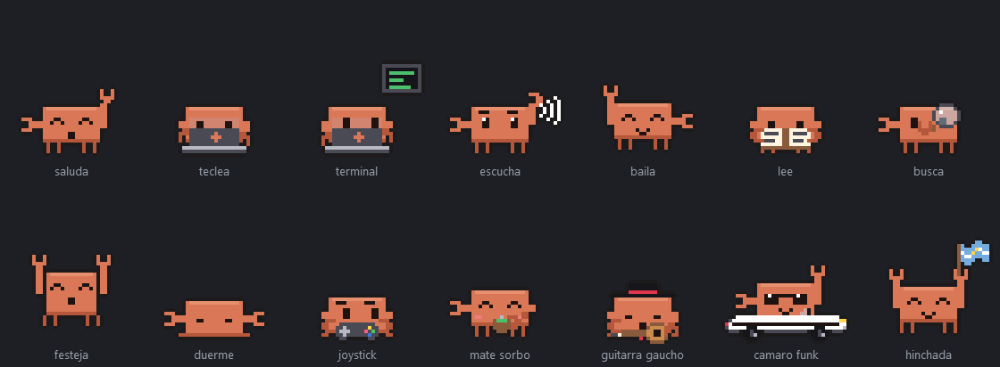

# Cangrejito 🦀

Una mascota de escritorio para Windows que **narra en voz alta lo que hace Claude Code** mientras vos hacés
otra cosa. Es un cangrejo pixel-art que vive sobre la barra de tareas, camina, se duerme si te vas, baila
con tu música y te avisa cuando Claude necesita algo.



> Proyecto de fan, **no oficial**. No está afiliado a Anthropic ni respaldado por Anthropic.
> «Claude» y «Claude Code» son marcas de Anthropic.

## Qué hace

- **Narra cada paso de Claude Code**, en castellano rioplatense y con voz natural (Piper, todo local):
  - qué archivo lee o edita;
  - qué comando corre y para qué;
  - qué encontró y qué va a probar;
  - cuándo terminó, con un resumen.
- **Te llama cuando hace falta:** si Claude necesita un permiso, te hace una pregunta o terminó el plan.
- **Funciona con varios chats a la vez:** dice de qué proyecto habla («Ahora lo de Unity: …»).
- **Avisa cuando el chat se está llenando** y conviene compactar.
- **Tiene su vida propia** en los ratos libres:
  - camina, se sienta, juega con el celular y toma mate;
  - duerme cuando no estás;
  - baila cuando suena Spotify;
  - toca la guitarra vestido de gaucho con folklore;
  - maneja un Camaro descapotable con phonk.
- **No molesta cuando jugás:** si un juego ocupa la pantalla completa (o abrís VRChat), se muda al otro
  monitor. Si no hay otro, se esconde y se calla. Mientras jugás, te acompaña con pochoclos o un joystick.
- **Se calla cuando le dictás a Claude** y pone cara de escuchar.

Se maneja con el mouse:
- **Clic:** silencia o activa la voz.
- **Doble clic:** mimo.
- **Arrastrarlo:** lo levantás y cae.
- **Clic derecho:** abre el menú.

## Requisitos

- Windows 10 u 11 (64 bits).
- [Claude Code](https://claude.com/claude-code): la app de escritorio de Claude (pestaña Code) o la
  terminal. Funciona con cualquier cuenta.
- Internet solo la primera vez, para bajar la voz (unos 110 MB).

## Instalar

1. Bajá `CangrejitoSetup.exe` desde [Releases](https://github.com/MaxCuratAnima/cangrejito/releases).
2. Abrilo. Como el instalador no tiene firma digital, Windows puede mostrar «Windows protegió su PC».
   Tocá **Más información → Ejecutar de todas formas**.
3. Elegí las opciones:
   - **Narración en castellano** (recomendada): le pide a Claude Code que explique cada paso en castellano,
     para que el cangrejito tenga qué contarte.
   - **Mostrarlo aunque la app de Claude esté cerrada:** si usás Claude Code solo en la terminal.
4. La primera vez te pregunta cómo llamarte.

Aparece solo cuando abrís la app de Claude y se despide cuando la cerrás.

### Qué cambia en tu PC

- **El programa:** se instala en `%LOCALAPPDATA%\Programs\Cangrejito`, sin pedir administrador.
- **Un acceso directo en Inicio de Windows:** un lanzador liviano que espera a que abras Claude.
- **Hooks en `%USERPROFILE%\.claude\settings.json`:** así Claude Code le avisa al cangrejito qué está
  haciendo. Antes de tocarlo se guarda una copia en `settings.antes-del-cangrejito.json`, y tus otros hooks
  no se tocan.
- **Si elegiste la narración en castellano:** un bloque marcado en tu `CLAUDE.md` global.
- **Tus ajustes:** en `%APPDATA%\Cangrejito`.

Al desinstalar (desde «Agregar o quitar programas») se sacan los hooks y el bloque del `CLAUDE.md`. Tus
ajustes quedan en `%APPDATA%\Cangrejito`, por si lo volvés a instalar.

## Privacidad

Todo corre en tu PC. El cangrejito **no manda nada a internet**: los eventos de Claude Code le llegan por
`127.0.0.1` y la voz se genera localmente. La única conexión es la descarga de la voz, una sola vez, desde
el repositorio oficial de voces de Piper en Hugging Face, verificada con su hash. Lo que narra queda en un
registro local (`%APPDATA%\Cangrejito\registro.txt`) que solo sirve para diagnosticar problemas.

## Ajustes

Se editan en `%APPDATA%\Cangrejito\config.json`:

| Ajuste | Qué hace |
|---|---|
| `nombre` | Cómo te llama |
| `volumen`, `velocidad`, `tono` | La voz (el volumen también está en el menú) |
| `afk_minutos` | A los cuántos minutos sin usar la PC se duerme |
| `comentar_musica` | Si de vez en cuando festeja el tema nuevo de Spotify |
| `artistas_guitarra`, `artistas_funk` | Artistas extra para la guitarra o el Camaro |
| `siempre_visible` | Mostrarlo aunque la app de Claude esté cerrada |

En `temas_auto.json` hay temas y artistas que lo suben al Camaro; se puede editar con el cangrejito andando.

## Desde el código

Necesitás Python 3.12 o más nuevo y estas librerías:

```bash
pip install PySide6-Essentials piper-tts psutil sounddevice soundfile numpy pycaw
```

- **Correrlo:** `pythonw cangrejito.pyw --ya` (`--ya` lo muestra aunque Claude esté cerrada).
- **Armar el instalador:**
  1. `python -m PyInstaller cangrejito.spec --noconfirm`
  2. `ISCC instalador\cangrejito.iss` (con [Inno Setup 6](https://jrsoftware.org/isinfo.php))
- **Herramientas en `dev/`:**
  - `galeria.py`: hoja con todas las poses.
  - `probar.py`: manda eventos falsos, como si fueran de Claude.

Cómo está armado:

```
Claude Code ──hooks──▶ Cangrejito.exe --avisar ──HTTP 127.0.0.1:47833──▶ narrador ──▶ voz + globo + animación
```

| Archivo | Qué hace |
|---|---|
| `narrador.py` | Convierte cada evento en una frase y una animación |
| `mascota.py` | Ventana, física, paseos, poses y mouse |
| `sprites.py` | El dibujo, pixel por pixel |
| `voz.py` | La voz (Piper) |
| `vigilante.py` | Mira la app de Claude, la pantalla completa, la música y el micrófono |

La voz XTTS (más natural, con placa de video) es opcional y no viene en el instalador; se configura con
`xtts_python` en `config.json`.

## Créditos

- **Voz «Daniela» ([Piper](https://github.com/rhasspy/piper), es_AR):** licencia CC BY-SA 4.0. Dataset
  [OpenSLR 61](https://www.openslr.org/61/) (Google, español argentino), entrenada por
  [larcanio](https://huggingface.co/larcanio/piper-voices). Se baja aparte; no es parte de este código.
- **Interfaz:** [PySide6](https://doc.qt.io/qtforpython-6/) (Qt for Python, LGPL).
- **Personaje:** cangrejito dibujado en código, inspirado en Clawd, la mascota de Claude Code.

Hecho por [MaxCuratAnima](https://github.com/MaxCuratAnima), con ayuda de Claude Code.

## Licencia

[MIT](LICENSE).
