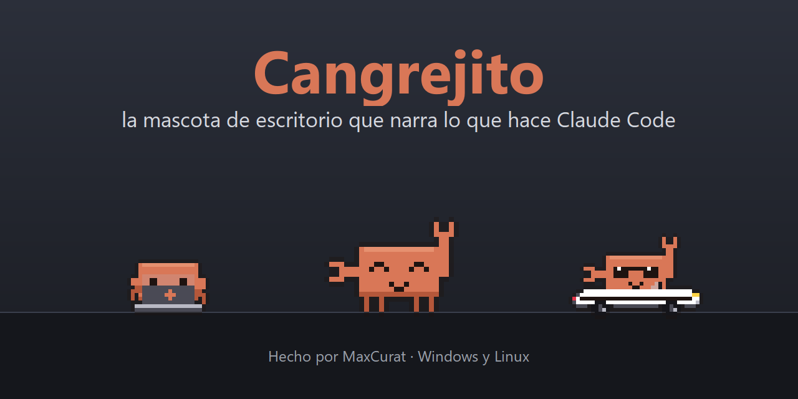
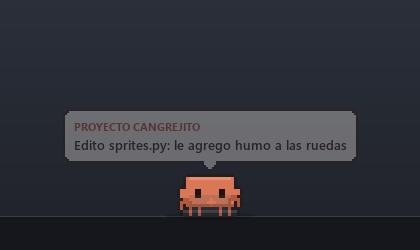
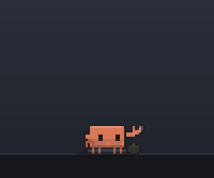
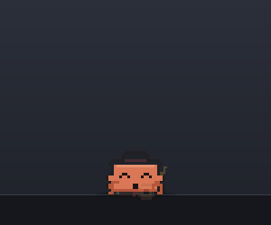
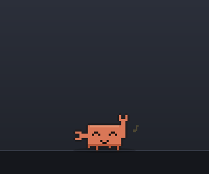
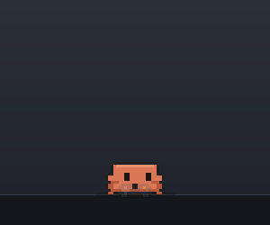

<p align="center">
  
</p>

<h3 align="center">Un cangrejito que vive en tu escritorio y te cuenta en voz alta lo que hace Claude Code.</h3>

<p align="center">
  <a href="https://github.com/MaxCuratAnima/cangrejito/releases/latest/download/CangrejitoSetup.exe"></a>
  &nbsp;
  <a href="https://github.com/MaxCuratAnima/cangrejito/releases/latest/download/Cangrejito-linux-x64.tar.gz"></a>
</p>

<p align="center">
  <b><a href="https://github.com/MaxCuratAnima/cangrejito/releases/latest/download/CangrejitoSetup.exe">Windows</a></b>
  ·
  <b><a href="https://github.com/MaxCuratAnima/cangrejito/releases/latest/download/Cangrejito-linux-x64.tar.gz">Linux</a></b>
  ·
  <a href="#cómo-se-instala">Cómo se instala</a>
  ·
  <a href="#qué-hace">Qué hace</a>
  <br><sub>Gratis y de código abierto · Hecho por <b>MaxCurat</b></sub>
</p>

---

## Cómo se instala

No hace falta saber nada de GitHub: tocá el botón de tu sistema y se baja solo.

### En Windows (10 u 11)

1. Tocá **[Descargar para Windows](https://github.com/MaxCuratAnima/cangrejito/releases/latest/download/CangrejitoSetup.exe)**. Se baja `CangrejitoSetup.exe`.
2. Abrilo. Si Windows muestra **«Windows protegió su PC»**, tocá **Más información → Ejecutar de todas formas**. Es normal: el instalador no tiene firma digital, que cuesta plata.
3. Seguí los pasos (**Siguiente, Siguiente, Instalar**). No pide ser administrador.

### En Linux

1. Tocá **[Descargar para Linux](https://github.com/MaxCuratAnima/cangrejito/releases/latest/download/Cangrejito-linux-x64.tar.gz)**.
2. Descomprimilo: clic derecho → **Extraer aquí**.
3. Abrí la carpeta en una terminal y escribí `./instalar.sh`. Te guía paso a paso.

La primera vez te da la bienvenida: le decís cómo llamarte y cómo querés que sea (si habla mucho o poco,
si comenta corto o al detalle, su personalidad y su voz), y baja su voz (unos 110 MB, una sola vez).
Después aparece solo cuando abrís Claude, y se despide cuando lo cerrás. Todo se cambia después con
clic derecho sobre el cangrejito.

> **¿Qué necesito?** [Claude Code](https://claude.com/claude-code), con cualquier cuenta. En Windows,
> con la app de escritorio de Claude o con la terminal. En Linux, con la terminal. Todas las versiones
> están en [Releases](https://github.com/MaxCuratAnima/cangrejito/releases).

---

## Qué hace

### Te cuenta lo que hace Claude, en voz alta

Mientras Claude Code trabaja, el cangrejito te dice qué archivo lee o edita, qué comando corre y para qué,
qué encontró y qué va a probar. Cuando termina, te hace un resumen. Si Claude necesita un permiso o te
hace una pregunta, te llama. Habla en castellano rioplatense, con una voz natural que se genera en tu PC.

<p align="center"></p>

### Se toma unos mates mientras labura

Cada tanto agarra el termo, se ceba un mate y lo toma mientras teclea con la otra pinza.

<p align="center"></p>

### Tiene vida propia en los ratos libres

<table>
<tr>
<td align="center" width="50%"><br><b>Con phonk o funk</b>, se sube a un Camaro descapotable con lentes y derrapa por la pantalla.</td>
<td align="center" width="50%"><br><b>Con folklore</b>, se viste de gaucho y toca la criolla.</td>
</tr>
<tr>
<td align="center"><br><b>Con cualquier tema</b> de Spotify baila, y a veces lo comenta («¡Uh, temazo!»).</td>
<td align="center"><br><b>Mientras jugás</b> en el otro monitor, juega con vos, come pochoclos o te alienta con la bandera.</td>
</tr>
</table>

Además camina, se sienta, juega con el celular, se duerme cuando no estás y te saluda cuando volvés.

### No molesta

- **Si un juego ocupa la pantalla completa** (o abrís VRChat), se muda al otro monitor. Si no hay otro, se esconde y se calla.
- **Si le dictás a Claude,** se calla y pone cara de escuchar.
- **Con varios chats de Claude a la vez,** te dice de cuál habla.
- **Si el chat se está llenando,** te avisa que conviene compactar.

### Se maneja con el mouse

| Hacés | Él… |
|---|---|
| Clic | Se calla o vuelve a hablar |
| Doble clic | Se pone mimoso |
| Arrastrar | Lo levantás; si lo sacudís, se marea |
| Clic derecho | Abre el menú con toda la configuración: cuánto habla, comentarios cortos o detallados, personalidad, música, volumen y velocidad de la voz |

<p align="center"></p>

---

## Privacidad

Todo corre en tu PC. El cangrejito **no manda nada a internet**: Claude Code le avisa lo que hace por una
conexión local (`127.0.0.1`), y la voz se genera en tu computadora. La única descarga es la voz, una sola
vez, desde el repositorio oficial de voces de Piper, y se verifica que sea la original.

## Qué cambia en tu PC

- **El programa:**
  - Windows: `%LOCALAPPDATA%\Programs\Cangrejito`.
  - Linux: `~/.local/share/cangrejito-programa`.
- **Arranque con la sesión:** un lanzador liviano que espera a que abras Claude.
- **Hooks en `~/.claude/settings.json`:** así Claude Code le avisa al cangrejito. Antes de tocarlo se guarda una copia, y tus otros hooks no se tocan.
- **Opcional:** unas reglas en tu `CLAUDE.md` global para que Claude explique cada paso en castellano.
- **Tus ajustes:** en `%APPDATA%\Cangrejito` (Windows) o `~/.local/share/cangrejito` (Linux). Están en `config.json`: nombre, volumen, velocidad de la voz, a los cuántos minutos se duerme, si comenta la música…

Al desinstalar se saca todo lo del cangrejito y Claude Code queda como estaba. Se desinstala así:
- **Windows:** desde «Agregar o quitar programas».
- **Linux:** con `desinstalar.sh`.

<details>
<summary><b>Notas para Linux</b></summary>

- **Escritorio:** funciona en X11. En Wayland corre por XWayland (viene en casi todas las distros).
- **Para que haga todo** (esconderse con juegos a pantalla completa, dormirse, bailar con Spotify):
  `sudo apt install x11-utils xprintidle playerctl libportaudio2`. Sin esos programas anda igual, pero
  esas partes se apagan.
- **Cuándo aparece:** en Linux no hay app de escritorio de Claude, así que aparece cuando corre Claude
  Code y se va cuando lo cerrás.
- **Dictado:** todavía no detecta cuándo le dictás a Claude.
</details>

---

## Para desarrolladores

<details>
<summary><b>Correrlo desde el código, armar los instaladores y cómo está hecho</b></summary>

Necesitás Python 3.12 o más nuevo:

```bash
pip install -r requirements.txt
python cangrejito.pyw --ya
```

`--ya` lo muestra aunque Claude esté cerrado. En Windows conviene `pythonw`, para que no quede una
consola abierta.

**Pruebas:** `pip install pytest && python -m pytest pruebas`. Corren sin pantalla, en Windows y en Linux.
GitHub Actions las pasa en cada cambio, y en cada versión (`git tag vX.Y.Z`) arma los dos instaladores y
los publica.

**Armar los instaladores a mano:**
1. `python -m PyInstaller cangrejito.spec --noconfirm`
2. Windows: `ISCC instalador\cangrejito.iss` (con [Inno Setup 6](https://jrsoftware.org/isinfo.php)).
3. Linux: empaquetar `dist/Cangrejito` junto con `instalador/linux/*.sh`.

**Herramientas en `dev/`:**
- `galeria.py`: todas las poses en una hoja.
- `gifs.py`: graba las animaciones de este README.
- `imagenes.py`: el banner, el ícono y las imágenes del instalador.
- `probar.py`: manda eventos falsos, como si fueran de Claude.

```
Claude Code ──hooks──▶ Cangrejito --avisar ──HTTP 127.0.0.1:47833──▶ narrador ──▶ voz + globo + animación
```

| Archivo | Qué hace |
|---|---|
| `narrador.py` | Convierte cada evento de Claude en una frase y una animación |
| `mascota.py` | Ventana, física, paseos, poses y mouse |
| `sprites.py` | El dibujo del cangrejito, pixel por pixel, en código |
| `voz.py` | La voz (Piper, local) |
| `vigilante.py` | Mira Claude, la pantalla completa, la música y el micrófono |
| `sistema_windows.py`, `sistema_linux.py` | Lo que cambia según el sistema |
| `instalar_claude.py` | Conecta y desconecta los hooks de Claude Code |

La voz XTTS (más natural, con placa de video) es opcional y no viene en los instaladores; se configura con
`xtts_python` en `config.json`.
</details>

---

## Créditos y licencia

**Cangrejito** fue creado por **MaxCurat** (© 2026). El código es libre, con [licencia MIT](LICENSE):
podés usarlo, cambiarlo y compartirlo, siempre que mantengas el aviso de autoría.

- **Voz «Daniela»** ([Piper](https://github.com/rhasspy/piper), es_AR): licencia CC BY-SA 4.0, dataset
  [OpenSLR 61](https://www.openslr.org/61/), entrenada por [larcanio](https://huggingface.co/larcanio/piper-voices).
  Se baja aparte; no es parte de este código.
- **Interfaz:** [PySide6](https://doc.qt.io/qtforpython-6/) (Qt for Python, LGPL).
- **Personaje:** dibujado en código, inspirado en Clawd, la mascota de Claude Code.

> Proyecto de fan, **no oficial**: no está afiliado a Anthropic ni respaldado por Anthropic.
> «Claude» y «Claude Code» son marcas de Anthropic.

<p align="center"><sub>Hecho con 🦀 y mate por <b>MaxCurat</b> · con ayuda de Claude Code</sub></p>
