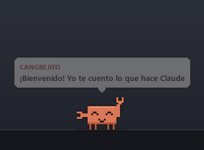
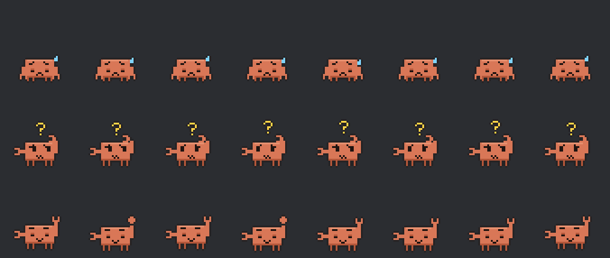
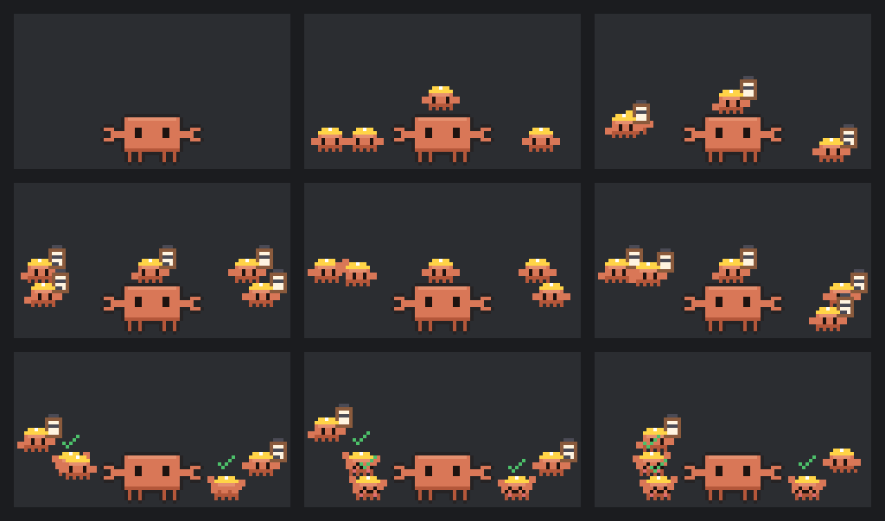
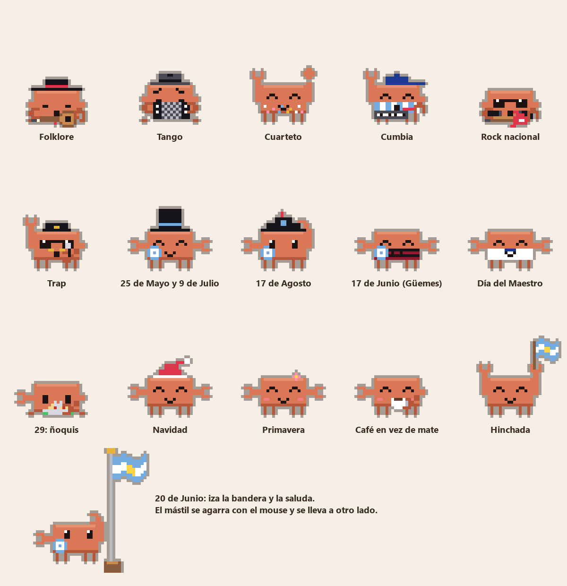

<p align="center">
  
</p>

<h1 align="center">¡Bienvenido!</h1>

<p align="center">
  
</p>

<h3 align="center">Un cangrejito que vive en tu escritorio y te cuenta en voz alta lo que hace Claude Code.</h3>

<p align="center">
  <a href="https://github.com/MaxCuratAnima/cangrejito/releases/latest/download/CangrejitoSetup.exe"></a>
  &nbsp;
  <a href="https://github.com/MaxCuratAnima/cangrejito/releases/latest/download/Cangrejito-linux-x64.tar.gz"></a>
</p>

---

## Por qué existe

Lo hice yo (MaxCurat) porque quería un compañero en la compu. Que me acompañe, que sea interactivo con
Claude y que me vaya contando lo que hace en los chats y en los proyectos, para no tener que estar mirando
la app todo el tiempo. Así puedo jugar o hacer otra cosa mientras Claude labura de fondo, y me entero por
la voz cuando necesita algo o cuando terminó.

Es un proyecto personal, hecho en Argentina. El personaje se inspira en el cangrejito de Claude Code, pero
lo dibujé de cero, pixel por pixel, en código. Puede tener bugs: si encontrás alguno, abrí un
[issue](https://github.com/MaxCuratAnima/cangrejito/issues) y lo miro.

## Cómo se instala

Necesitás tener [Claude Code](https://claude.com/claude-code) (con cualquier cuenta). En Windows sirve la
app de escritorio de Claude o la terminal; en Linux, la terminal.

### Windows 10 u 11

1. Bajá **[CangrejitoSetup.exe](https://github.com/MaxCuratAnima/cangrejito/releases/latest/download/CangrejitoSetup.exe)**.
2. Abrilo. Si Windows dice **«Windows protegió su PC»**, tocá **Más información → Ejecutar de todas formas**.
   Pasa porque el instalador no tiene firma digital (cuesta plata y esto es gratis).
3. **Siguiente, Siguiente, Instalar.** No pide ser administrador.
4. Abrí Claude. El cangrejito aparece solo y se va cuando cerrás la app.

Si algo sale mal al conectarlo con Claude Code, el instalador te avisa con un cartel.

### Linux (x64, X11 o XWayland)

1. Bajá **[Cangrejito-linux-x64.tar.gz](https://github.com/MaxCuratAnima/cangrejito/releases/latest/download/Cangrejito-linux-x64.tar.gz)**.
2. Descomprimilo (clic derecho → **Extraer aquí**) o, en la terminal: `tar xzf Cangrejito-linux-x64.tar.gz`.
3. Entrá a la carpeta y corré `./instalar.sh`. Te va guiando.
4. Abrí Claude Code. Aparece cuando corre y se va cuando lo cerrás.

Para que haga todo en Linux (esconderse con juegos a pantalla completa, dormirse, bailar con Spotify):
`sudo apt install x11-utils xprintidle playerctl libportaudio2`. Sin eso anda igual, pero esas partes quedan apagadas.
Lo probé bastante menos que la versión de Windows.

### La primera vez

Te da la bienvenida y te pregunta cómo llamarte y cómo lo querés (si habla mucho o poco, corto o con detalle).
Después baja su voz, unos 110 MB, una sola vez. Todo se cambia más tarde con clic derecho sobre el cangrejito.

Para desinstalarlo: en Windows, desde «Agregar o quitar programas»; en Linux, con `desinstalar.sh`.
Todas las versiones están en [Releases](https://github.com/MaxCuratAnima/cangrejito/releases).

---

## Qué hace

### Te cuenta lo que hace Claude, en voz alta

Mientras Claude Code trabaja, te dice qué archivo lee o edita, qué comando corre y para qué, y qué encontró.
Cuando termina, te hace un resumen. Si Claude necesita un permiso o te hace una pregunta, te llama.
Habla en castellano rioplatense con una voz que se genera en tu PC. Se alegra cuando algo sale, se pone
triste cuando falla, duda si quedó a medias y dice «bastante bien» cuando salió con detalles. Si festeja,
grita «¡Golazo!» y tira confeti.

<p align="center"></p>

<p align="center"><br><sub>De arriba para abajo: cuando falla, cuando queda a medias y cuando sale «bastante bien».</sub></p>

### Un mini-cangrejo por cada agente

Cuando Claude manda ayudantes a trabajar en paralelo, aparece un mini-cangrejo con casquito de obra y una
tablita por cada uno. El primero se sube a la cabeza; los demás se reparten a los costados. Se saludan,
chocan las pinzas, hacen torres y, cuando terminan, se quedan al lado con un tilde verde.

<p align="center"></p>

### Se toma unos mates mientras labura

Cada tanto agarra el termo, se ceba un mate y lo toma mientras teclea con la otra pinza. ¿No tomás mate?
En la configuración elegís café, té o nada.

<p align="center"></p>

### Tiene vida propia en los ratos libres

<table>
<tr>
<td align="center" width="50%"><br><b>Con phonk o funk</b>, se sube a un Camaro descapotable y derrapa por la pantalla.</td>
<td align="center" width="50%"><br><b>Con folklore</b>, se viste de gaucho y toca la criolla (o gira con un pañuelo en la chacarera).</td>
</tr>
<tr>
<td align="center"><br><b>Con cualquier tema</b> de Spotify baila, y a veces lo comenta.</td>
<td align="center"><br><b>Mientras jugás</b> en el otro monitor, juega con vos, come pochoclos o te alienta con la bandera.</td>
</tr>
</table>

Cuando no pasa nada también hace cosas: malabares, burbujas, sentadillas, se estira, estornuda, espanta una
mosca, juega con el celular, se duerme si no estás y te saluda cuando volvés. Si lo mimás varias veces seguidas
le dan cosquillas, y si lo mirás con el mouse encima demasiado rato, te lo comenta.

### Se viste según la música y las fechas argentinas

Reconoce a los artistas de cada género y se pone su ropa:

| Género | Qué hace o se pone | Algunos artistas que reconoce |
|---|---|---|
| Folklore | Sombrero y pañuelo de gaucho, guitarra criolla; en la chacarera gira con el pañuelo | Chaqueño Palavecino, Mercedes Sosa, Soledad, Los Nocheros |
| Tango | Funyi, pañuelo blanco y bandoneón | Gardel, Piazzolla, Julio Sosa, Goyeneche |
| Cuarteto | Camisa con brillos, y a bailar | La Mona Jiménez, Rodrigo, Ulises Bueno |
| Cumbia | Gorrita, camiseta albiceleste y teclado | Damas Gratis, Los Palmeras, Gilda, L-Gante |
| Rock nacional | Campera de cuero, lentes y eléctrica | Soda Stereo, Charly García, Spinetta, La Renga |
| Metal | Melena larga y campera | Rata Blanca, Hermética, Almafuerte, Metallica |
| Trap | Gorra, cadena, lentes y micrófono | Duki, Bizarrap, Nicki Nicole, Trueno |
| Electrónica | Casco dorado de robot | Daft Punk |
| Disco | Lentejuelas y bola de disco | Bee Gees, Donna Summer |
| Reggae | Gorro con rastas | Bob Marley |
| Clásica | Peluca de director | Mozart, Beethoven |
| Phonk y funk | El Camaro blanco | Kordhell, DVRST, Interworld |

En la configuración podés apagar géneros y sumar tus artistas.

En las **fechas patrias** lleva la escarapela y su ropa (galera el 25 de Mayo y el 9 de Julio, bicornio el 17
de Agosto, poncho salteño por Güemes) y cada tanto cuenta una curiosidad del día. El 20 de Junio planta un
mástil, iza la bandera y la saluda; el mástil lo podés arrastrar con el mouse. También festeja el Día del
Amigo, del Mate, del Tango y la Pachamama, y los **ñoquis el 29**. Los días de memoria (24 de marzo y 2 de
abril) no festeja ni hace chistes.

<p align="center"></p>

### Se adapta a vos

En el clic derecho cambiás cómo te trata («compañero», «compañera» o sin género), qué toma, tu bandera para
alentarte, cuánto habla, si dice malas palabras, si te recuerda hacer pausas activas, qué música lo hace
bailar y cuánto respira al hablar.

### No molesta

- Si un juego ocupa la pantalla completa (o abrís VRChat), se muda al otro monitor. Si no hay otro, se esconde y se calla.
- Si le dictás a Claude, se calla y pone cara de escuchar.
- Con varios chats de Claude a la vez, te dice de cuál habla.
- Si el chat se está llenando, te avisa que conviene compactar.

### Se maneja con el mouse

| Hacés | Él… |
|---|---|
| Clic | Se calla o vuelve a hablar |
| Doble clic | Se pone mimoso |
| Arrastrar | Lo levantás; si lo sacudís, se marea |
| Clic derecho | Abre el menú con toda la configuración |

<p align="center"></p>

---

## Privacidad

Todo corre en tu PC y no manda nada a internet. La única conexión externa es la descarga de la voz, una vez,
desde el repositorio oficial de voces de Piper (se verifica que el archivo sea el original).

Para poder hacer lo que hace, mira esto en tu compu:

- Lo que Claude Code le avisa por una conexión local (`127.0.0.1`): qué herramienta usa, el archivo o comando, y lo último que escribió Claude (lo lee de tu carpeta `~/.claude`).
- El título de lo que suena en Spotify, para vestirse y bailar según el género.
- Si el micrófono está en uso, para callarse cuando le dictás a Claude.
- Qué ventana está en pantalla completa, para esconderse cuando jugás.
- **Chats comunes de Claude: viene apagado.** Si lo prendés en la configuración, lee la ventana de la app para comentar esos chats. Eso incluye lo que ves en pantalla del chat, así que pensalo si hablás de cosas privadas.

Guarda un registro local en `%APPDATA%\Cangrejito\registro.txt` con las frases que dijo (el comienzo de cada una),
los temas que sonaron y los nombres de tus proyectos. Se queda en tu PC; podés borrarlo cuando quieras.

## Qué cambia en tu PC

- **El programa:** Windows en `%LOCALAPPDATA%\Programs\Cangrejito`; Linux en `~/.local/share/cangrejito-programa`.
- **Arranque con la sesión:** un lanzador liviano que espera a que abras Claude.
- **Hooks en `~/.claude/settings.json`:** así Claude Code le avisa al cangrejito. Antes de tocarlo se guarda una copia, y tus otros hooks no se tocan.
- **Opcional:** unas reglas en tu `CLAUDE.md` global para que Claude explique cada paso en castellano.
- **Tus ajustes:** en `%APPDATA%\Cangrejito` (Windows) o `~/.local/share/cangrejito` (Linux), en `config.json`.

Al desinstalar se sacan el programa y los hooks. Quedan tus ajustes, el registro y la voz descargada en
`%APPDATA%\Cangrejito` (unos 110 MB): si no los querés, borrá esa carpeta.

<details>
<summary><b>Notas para Linux</b></summary>

- **Escritorio:** funciona en X11. En Wayland corre por XWayland (viene en casi todas las distros).
- **Cuándo aparece:** en Linux no hay app de escritorio de Claude, así que aparece cuando corre Claude Code y se va cuando lo cerrás.
- **Dictado:** todavía no detecta cuándo le dictás a Claude.
</details>

---

## Para desarrolladores

<details>
<summary><b>Correrlo desde el código, armar los instaladores y cómo está hecho</b></summary>

Necesitás Python 3.12 o más nuevo:

```bash
pip install -r requirements.txt
python cangrejito.pyw --ya
```

`--ya` lo muestra aunque Claude esté cerrado. En Windows conviene `pythonw`, para que no quede una
consola abierta.

**Pruebas:** `pip install pytest && python -m pytest pruebas`. Corren sin pantalla, en Windows y en Linux.
GitHub Actions las pasa en cada cambio, y en cada versión (`git tag vX.Y.Z`) arma los dos instaladores y
los publica.

**Armar los instaladores a mano:**
1. `python -m PyInstaller cangrejito.spec --noconfirm`
2. Windows: `ISCC instalador\cangrejito.iss` (con [Inno Setup 6](https://jrsoftware.org/isinfo.php)).
3. Linux: empaquetar `dist/Cangrejito` junto con `instalador/linux/*.sh`.

**Herramientas en `dev/`:**
- `galeria.py`: todas las poses en una hoja.
- `gifs.py`: graba las animaciones de este README.
- `outfits.py`: arma la imagen de la ropa por género y por fecha.
- `muestras_voz.py`: graba muestras de la voz con cada ánimo y el confeti, para escucharlas.
- `imagenes.py`: el banner, el ícono y las imágenes del instalador.
- `probar.py`: manda eventos falsos, como si fueran de Claude.

```
Claude Code ──hooks──▶ Cangrejito --avisar ──HTTP 127.0.0.1:47833──▶ narrador ──▶ voz + globo + animación
```

| Archivo | Qué hace |
|---|---|
| `narrador.py` | Convierte cada evento de Claude en una frase y una animación |
| `mascota.py` | Ventana, física, paseos, poses y mouse |
| `sprites.py` | El dibujo del cangrejito, pixel por pixel, en código |
| `voz.py` | La voz (Piper, local) |
| `vigilante.py` | Mira Claude, la pantalla completa, la música y el micrófono |
| `sistema_windows.py`, `sistema_linux.py` | Lo que cambia según el sistema |
| `instalar_claude.py` | Conecta y desconecta los hooks de Claude Code |

La voz XTTS (más natural, con placa de video) es opcional y no viene en los instaladores; se configura con
`xtts_python` en `config.json`.
</details>

---

---

## Con qué está hecho

- **Lenguaje:** Python 3, con PySide6 (Qt) para la ventana y el dibujo pixel por pixel.
- **Voz:** Piper con la voz «Daniela» en español argentino. Corre en tu PC, sin internet. No viene en este repositorio: se baja una vez al abrirlo por primera vez.
- **Instaladores:** PyInstaller + Inno Setup para Windows, y un `.tar.gz` con `instalar.sh` para Linux, armados por GitHub Actions.
- **Código a la vista, uso no comercial:** licencia PolyForm Noncommercial. Podés bajarlo, usarlo, estudiarlo, cambiarlo y compartirlo gratis; no se puede vender ni usar para un negocio.

---

## Créditos y licencia

**Cangrejito** lo hizo **MaxCurat** (© 2026). El código está a la vista bajo la licencia
[PolyForm Noncommercial 1.0.0](LICENSE): es gratis para uso personal, de estudio y sin fines de lucro, pero
**no se puede usar con fines comerciales** (venderlo, meterlo en un producto o servicio pago, usarlo para un
negocio). Si querés usarlo comercialmente, escribime por un [issue](https://github.com/MaxCuratAnima/cangrejito/issues)
y lo hablamos. Ojo: por eso no es «código abierto» en el sentido estricto; es código visible con uso libre no comercial.

- **Voz «Daniela»** ([Piper](https://github.com/rhasspy/piper), es_AR): licencia CC BY-SA 4.0, dataset
  [OpenSLR 61](https://www.openslr.org/61/), entrenada por [larcanio](https://huggingface.co/larcanio/piper-voices).
  Se baja aparte; no es parte de este código.
- **Interfaz:** [PySide6](https://doc.qt.io/qtforpython-6/) (Qt for Python, LGPL).
- **Personaje:** dibujado en código, inspirado en Clawd, el cangrejito de Claude Code.

> Proyecto de fan, **no oficial**: no está afiliado a Anthropic ni respaldado por Anthropic.
> «Claude» y «Claude Code» son marcas de Anthropic.

<p align="center"><sub>Hecho en Argentina con mate · por <b>MaxCurat</b> · escrito con ayuda de Claude Code</sub></p>
